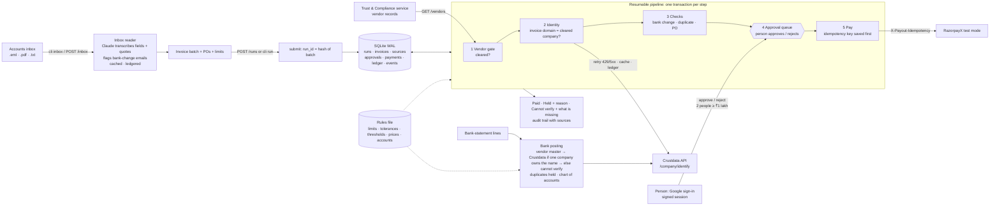

# Architecture

Also in the picture:
- **Vendor check (5.1 + 5.2)** runs inside step 1 when the vendor master has no Trust status (`app/trust.py`). It uses `/company/identify`, `/company/enrich`, `/web/enrich/live` and `/web/search/live`, and is cached per vendor.
- **Payouts** go to RazorpayX test mode when its keys are set, otherwise to a local sandbox. The sandbox is labelled as simulated and keeps the same idempotency contract.
- **Cost ledger:** every Crustdata, model and payout call is recorded there. `/economics` turns it into cost per job.

Where things sit:
- **Data calls:** `app/crustdata.py`. It retries with backoff on 429, 5xx and timeouts, caches every response in `http_cache`, and raises `SourceUnavailable`, which holds the case rather than reading silence as an answer.
- **Approvals:** the `approvals` table, approved or rejected by a person through the UI, the API or the CLI. Results can't be edited.
- **Retries and restarts:** each step commits its new state in one transaction. On restart, `resume_all()` continues every run still in progress. A payment reuses its saved idempotency key.
- **Cost ledger:** the `ledger` table. Each row is one call, with its credits (from the `x-credits-used` header), whether it came from the cache, its latency and its status. A run stops making calls at its `cost_limit` and checks no new invoices after its `time_limit_s`.
